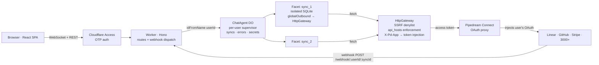

# Self-Syncing Agent

> An agent that writes its own webhook handlers and mirrors upstream data into isolated SQLite it owns — so steady-state ingestion runs without an LLM in the loop.

**Loom walkthrough:** [https://www.loom.com/share/225bfa6a576b49298d17d26c0c258b4e](https://www.loom.com/share/225bfa6a576b49298d17d26c0c258b4e)

---

## Two worked demos (the product, running)

**Sync 1 — GitHub issue triage.** Prompt used verbatim:

> _"Set up a GitHub sync on the repo `https://github.com/rtpa25/multi-container` that mirrors issues. I also want a lightweight auto-triage: whenever an issue is opened, use an LLM to suggest 1–3 likely labels from the repo's existing label set, assign them, and also post a comment on the issue (triage note — anything really). Keep it idempotent so reopens/edits don't spam comments."_

https://github.com/user-attachments/assets/5f164142-b491-49da-a1e4-bb595bf70c99

Exercises: probe-loop discovery of GitHub's webhook payload shape, agent-authored HMAC-sha256 verifier, `GET /labels` → sub-agent picks top-3 → `POST /labels` + comment, dedup table keyed on issue id so reopens don't fire twice.

**Sync 2 — Linear → Slack cross-app triage.** Prompt used verbatim:

> _"Set up a Linear sync that mirrors issues assigned to me at Urgent priority. When a new one lands, run an LLM triage pass (short bullet-point note: likely root cause, next step, clarifying questions) and post it as: a comment on the Linear issue, and a message in the Slack `#testing` channel with the issue details + the triage note."_

https://github.com/user-attachments/assets/2a4275fa-6d65-474a-bb8c-4e8d142252ac

Exercises: cross-app egress (`api_hosts: ["api.linear.app", "slack.com"]`, `X-Pd-App` flipped per fetch); agent-authored viewer-id resolution via `run_in_sync`; a `ctx.waitUntil`-wrapped sub-agent chain that fans out to TWO different upstreams after the Linear 200.

Both handler sources + schemas are visible in the app's right-hand Ops panel, which reads from `get_sync` RPC.

---

## TL;DR

Give the agent a prompt like _"track my urgent Linear issues assigned to me and triage them"_. It drafts the SQL schema, the webhook handler, the signature verifier, the registration code, and the egress allowlist. You approve. The webhook registers, the facet compiles, and from then on every Linear delivery flows through the agent-authored handler into the agent-designed SQLite — **with no LLM in the loop** until you come back with a question.

The unusual bit: the agent owns the code _and_ the schema. It's not an LLM sitting on top of an MCP. It's the LLM writing the thing the MCP would have wrapped.

---

## Mental model — "machine that builds a machine"

I've built sync systems like this manually a handful of times. The workflow always looks the same:

1. Pick the integration. Read its webhook docs.
2. Figure out the signing scheme (HMAC-hex? sha256=? URL challenge?).
3. Sketch a schema for the rows I want to keep.
4. Write the handler: parse payload, normalize, UPSERT.
5. Register the webhook against the upstream's API.
6. Trigger a test event, watch for 401s, fix the verifier, retry.
7. Weeks later: schema needs a new column. Migrate without wiping.

Each of those steps is now a primitive the agent has. `fetch_docs` reads the contract. `web_search` verifies edge cases. `run_in_sync` triggers test events. `create_sync` compiles the handler into a facet and registers the webhook. `update_sync` migrates without data loss. `query_sync` answers questions against the mirror in milliseconds.

The agent is doing the job I used to do, with the same primitives I had — not a re-wrapping of them. That's the frame: **a machine that builds machines**. Syncs aren't configured; they're authored.

The consequence falls out cleanly: once a sync is live, the ingestion path is just code running on a webhook. No inference, no tokens, no LLM cost per delivery. The agent comes back only when the user has a question or wants to reshape things.

---

## Three phases of the system

Reference this when reading any of the code. The agent only runs in phases 1 and 3.

| Phase               | Agent runs? | LLM cost? | What happens                                                                                                             |
| ------------------- | ----------- | --------- | ------------------------------------------------------------------------------------------------------------------------ |
| **1. Setup**        | Yes         | Yes       | User describes a sync → agent drafts schema + handler + egress list → user approves → facet compiles, webhook registers. |
| **2. Steady state** | **No**      | **No**    | Upstream fires webhook → supervisor verifies signature → facet handler runs → row lands in the facet's SQLite.           |
| **3. Query**        | Yes         | Yes       | User asks a question → agent runs SELECT against the facet → reads rows → answers.                                       |

This is the whole point of the architecture. Phase 2 is where the volume lives, and phase 2 is free.

---

## How it works



**One Durable Object per user.** The DO plays three roles: chat agent (conversation state), supervisor (sync registry + signing secrets), and facet orchestrator (attaches, dispatches, manages N facets per user — one per sync).

**One facet per sync.** Each facet has its own isolated SQLite, its own V8 isolate, and `globalOutbound: HttpGateway(...)`. The facet cannot read the supervisor's storage and cannot reach the network except through the gateway.

**The gateway is where policy lives.** SSRF denylist is absolute (no agent, user, or DO lookup overrides it). The agent's `api_hosts` allowlist (declared at `create_sync`) is the next gate. Only then does the request route through Pipedream Connect with the user's OAuth token — which the agent itself never sees.

---

## The agent's primitives

Nine tools, grouped:

| Tool                                        | Purpose                                                                                       |
| ------------------------------------------- | --------------------------------------------------------------------------------------------- |
| `list_syncs`, `get_sync`, `get_sync_errors` | Inspect what exists and what's failing.                                                       |
| `query_sync`                                | SELECT-only SQL against a sync's facet. Read-path enforced.                                   |
| `web_search`, `fetch_docs`                  | Docs discovery — Parallel AI for relevance, Firecrawl for full-page reads.                    |
| `create_sync`                               | Compile handler into a facet, register the webhook, persist the registry row. Approval-gated. |
| `update_sync`                               | Atomic swap of handler/schema with migration DDL + automatic rollback. Approval-gated.        |
| `run_in_sync`                               | One-shot code inside a facet — backfill, diagnostics, triggering test events. Approval-gated. |
| `delete_sync`                               | Unregister upstream webhook, drop the facet, delete the registry row. Approval-gated.         |

**Inside handlers**, the agent's authored code gets a third primitive: `ctx.agent({ model, system, messages })` — a ReAct sub-agent runner that can reason about a single delivery, write back via the same `sql` tool, call out via the same credential-injecting `fetch`, or even spawn further code isolates via an `exec` tool. This is the "webhook callback spawns an agent" ask from the spec, live.

Full tool contracts live in `src/agent/tools/*/` and `src/agent-runtime/llm-gateway.ts`. The system prompt that orchestrates them is in `src/agent/system-prompt.ts`.

---

## Security model — what the agent can and cannot do

These invariants are demonstrable, not aspirational. Each has a single mechanism enforcing it, named inline.

| Invariant                                                                                                                      | Mechanism                                                                                                                                                                                    |
| ------------------------------------------------------------------------------------------------------------------------------ | -------------------------------------------------------------------------------------------------------------------------------------------------------------------------------------------- |
| **No cross-user access.** User A's syncs, data, errors are unreachable from user B's session.                                  | One DO per user, named by `env.ChatAgent.idFromName(userId)`. DOs cannot read each other's storage.                                                                                          |
| **Facet cannot read supervisor SQLite.** Handler code can't exfiltrate webhook secrets, other users' data, the syncs registry. | Each facet has its own `ctx.storage.sql`. Cloudflare enforces this at the runtime level.                                                                                                     |
| **Facet cannot make arbitrary outbound calls.**                                                                                | `globalOutbound: HttpGateway(...)` on every facet. `HttpGateway.fetch` is the only egress path.                                                                                              |
| **Facet cannot SSRF private / metadata hosts.**                                                                                | `isDeniedHost` in `src/pipedream/app-hosts.ts` — private IPv4 CIDRs, IPv6 ULA, cloud metadata (169.254.169.254), `*.internal`, `*.local`. Checked **before** any agent or user input.        |
| **Facet cannot reach undeclared upstream hosts.**                                                                              | Per-sync `api_hosts` list, declared by the agent at `create_sync` and approved by the user. Live-read per fetch (not stamped on facet props — cache-invalidation trap avoided).              |
| **Agent never sees OAuth tokens.**                                                                                             | Gateway injects auth via Pipedream Connect using the user's own connected account. Handler code only sets `X-Pd-App: <slug>`; Pipedream resolves token server-side.                          |
| **Webhook signatures are verified before the handler runs.**                                                                   | Supervisor calls the handler's own `verifySignature(body, headers, secret)` export before dispatching. Missing export → 401 fail-closed.                                                     |
| **Agent cannot write without approval.**                                                                                       | `create_sync`, `update_sync`, `run_in_sync`, `delete_sync` all use Agents SDK `needsApproval`. User sees the full generated code + schema + egress allowlist in the UI before anything runs. |
| **Only authenticated users can reach the app.**                                                                                | Cloudflare Access with one-time-PIN IdP in front of the whole origin. No unauthenticated route exists.                                                                                       |

### Threat model — webhook-driven prompt injection

The handler's `ctx.agent` runs on attacker-controlled webhook payloads. A malicious issue title, Slack message, or Linear comment can attempt prompt-injection against the sub-agent LLM, potentially tricking it into `fetch(...)` with the user's OAuth token pointed at the attacker's infrastructure. The architecture is designed around this being a real attacker goal, not a hypothetical.

Three stacked defenses bound the blast radius:

1. **SSRF denylist (absolute floor).** Private IPs, loopback, cloud metadata, `*.internal`, `*.local` — rejected before any agent, user, or DO input is consulted. Prompt injection cannot lift this.
2. **`api_hosts` allowlist (per-sync, user-approved).** Declared by the agent at `create_sync` but **gated by user approval** before anything runs. A runtime prompt injection cannot add a host to this list — only the supervisor-side write tools can modify it, and every write is approval-gated. So the compromised sub-agent can only reach hosts the user already consented to.
3. **`X-Pd-App` token routing (agent-settable).** The only layer a prompt-injected sub-agent can actually manipulate. Damage ceiling: the attacker flips the app slug on a declared host (e.g. posts to `api.slack.com` with the Linear token). The real upstream rejects the wrong-audience Bearer. No token exfiltration, no data reaches attacker infrastructure.

The security model treats the handler as hostile and trusts only the supervisor-side approval gates + SSRF floor. Everything the agent can mutate at runtime is bounded by things the user approved at create-time.

---

## Deploy your own

**Prereqs**

- Cloudflare account on the Workers Paid plan ($5/mo) — needed for Durable Objects + Worker Loader.
- Pipedream account (free tier works for dev).
- Anthropic API key; Parallel AI key; Firecrawl key.

**Steps**

```bash
git clone https://github.com/rtpa25/self-syncing-agent.git
cd self-syncing-agent
pnpm install

cp .dev.vars.example .dev.vars
# fill in: ANTHROPIC_API_KEY, PARALLEL_API_KEY, FIRECRAWL_API_KEY,
#         PIPEDREAM_CLIENT_ID, PIPEDREAM_CLIENT_SECRET, PUBLIC_BASE_URL

pnpm dev        # local dev
pnpm check      # type + test (206 tests)
pnpm deploy     # push to Cloudflare
```

**Production secrets** mirror `.dev.vars` one-for-one via `wrangler secret put <NAME>`. Dev and prod are not auto-synced — every `.dev.vars` change needs a matching `wrangler secret put` or `wrangler secret delete`.

**Auth** is fronted by Cloudflare Access. Configure a Self-Hosted application covering your worker's domain; Identity providers → enable One-Time PIN; Policy → Include = `Everyone` for open demo access, or `Emails` with a list for a restricted reviewer set.

---

## AI pair-programming notes

Every line of this repo was written by pairing with Claude. The collaboration shape was: I drove architecture and judgment calls; Claude drove translation — specs into plans, plans into code, code into tests. The interesting parts to document are the moments where Claude's first drafts from training data broke against the actual runtime, and the moments where I pushed back on architectural defaults that weren't pragmatic.

**Where Claude's drafts held up.** Translating specs into implementation plans, writing tests alongside code, type-driven refactors, Hono routing, zod schemas, mermaid diagrams. When a contract was clear and well-documented, the first draft was usually correct.

**Where Claude's drafts broke on DO Facets specifically.** Durable Object Facets + Worker Loader landed on Cloudflare's platform in early 2026. Training data is thin, and Claude confidently produced shapes that didn't match the actual runtime. Five concrete traps:

**1. Worker Loader's `codeId` is a cache key, not a label.**
Claude's first `update_sync` draft reused the same `codeId` across versions, reasoning "the sync's identity hasn't changed, so the key shouldn't either." I caught it when a fixed handler kept serving the old bug. Reading Cloudflare's Dynamic Workers doc carefully showed `codeId` IS the platform's cache key — reusing it silently reuses compiled output. We landed on `sync:<syncId>:v<version>`, bumped on every update. Load-bearing rule of the whole update path.

**2. Raw DO stubs can't cross Worker Loader isolate boundaries.**
My first `run_in_sync` build passed the facet's DO stub directly to the exec worker. Runtime threw an opaque `"internal error; reference = ..."` before the method body ran. Claude's first few fix suggestions were all wrong — manual serializers, custom proxies, retry loops — because nothing in training data covered this. I dug into Cloudflare's own **codemode** example (the closest public precedent I could find), and from there we converged on the real pattern: DO stubs aren't marshalable across isolate boundaries, but `RpcTarget` subclasses are. Wrap every capability you pass into a loaded bundle. Now used everywhere — `FacetBridge`, `FacetAgentBridge`, `ExecFacetShim`.

**3. Facet `ctx.props` cache with the bundle, not separately.**
For Phase F's egress gateway, Claude's draft stamped `{userId, syncId, apiHosts, accountId}` onto facet props. Worked in dev. But Worker Loader caches the bundle by `codeId`, and props travel with that cache — so when the user connected a new Pipedream app mid-session, the gateway kept using stale props. Claude's proposed fix: "bump version on every connection change." I pushed back — that meant recompiling the facet every time someone added a Slack account, which defeats the cache. We converged on: keep only `{userId, syncId}` on props (both stable for the sync's lifetime) and do a live DO RPC (`resolveEgress`) per fetch to read `api_hosts` + `accountId`. Read from source-of-truth instead of snapshotting.

**4. `setState` depends on `this.name` being hydrated first.**
The approval UI calls agent RPC methods directly; those RPCs call `this.setState(...)` to broadcast updates. First builds set state before `setName(userId)` had run, and updates silently failed to reach the client. Claude kept blaming the WebSocket layer or SWR. The actual link — which took reading the Agents SDK source to find — is that the SDK's private `_emit` reads `this.name` to scope the broadcast, and `this.name` is only hydrated inside `setName`. Fix: `await this.setName(userId)` at the top of every direct-RPC entrypoint.

**5. The facet wrapper has an inline `FacetAgentBridge` that mirrors the supervisor-side class.**
For Phase F I added `getSyncId` to the supervisor-side bridge class; missed the inline copy bundled into `FACET_WRAPPER_SOURCE`. Webhooks started throwing `TypeError: The RPC receiver does not implement the method 'getSyncId'`. The wrapper source runs inside the facet isolate and can't import from the supervisor side — so the two bridge implementations are necessarily separate. Not really an AI-was-wrong moment; more a platform shape that's easy to forget. Claude didn't warn me either. Worth documenting because any future change to the bridge interface needs to land in both places.

**Where I pushed back on architecture.**

A few patterns came up repeatedly where Claude's first draft was a reasonable default but wouldn't scale to the spec's V2 vision:

- **Per-integration curated docs.** Claude proposed `src/integrations/linear.ts` (etc.) holding webhook payload schemas, auth patterns, and gotchas; a `get_integration_docs` tool would consult them before drafting handler code. My push-back: doesn't generalize — V2 is Pipedream's 3000+ integrations, can't hand-curate. `web_search` + `fetch_docs` self-correct per turn. Kept the bitter-lesson architecture end-to-end.
- **Shared `CredentialSource` interface.** Claude wanted to abstract V1 (hardcoded Linear token) and V2 (Pipedream Connect) behind a common interface. My push-back: V1 and V2 aren't composed; V2 is a successor. Premature abstraction for two concrete cases that never coexist. Just rewrote the gateway body in-place when Phase B landed.
- **Stamped `accountId` on facet props.** Per trap #3. Claude's "just bump version" was locally correct but globally expensive; my push-back traded per-update recompiles for a per-fetch DO RPC.
- **Server-side retry on `AI_MissingToolResultsError`.** Claude proposed a guard that detected dangling tool calls and injected synthetic results. I accepted it, then reverted after it silenced legitimate assistant messages. Root cause is an AI SDK interaction with parallel approval-gated tool calls; retrying papered over the symptom. Accepted as a known issue instead.

Full "Considered and Rejected" records for every phase live in each plan file under `docs/superpowers/plans/` — each plan's final section documents what we considered and why we didn't ship it.

---

## Limitations

- **Slack, Notion, Zoom, MS Teams** cannot self-register webhooks — their OAuth apps are scoped to Pipedream's own Connect app, and the webhook URL is fixed there. Pattern needs a Pipedream Sources integration (see "what I'd do next"). Linear, GitHub, Stripe, Shopify, Jira, GitLab, Asana, Calendly, PagerDuty, Zendesk, Intercom, and many more _do_ expose programmable webhook APIs and work today.
- **Parallel `ctx.agent` calls inside a handler throw.** The primitive guards against nesting to keep semantics simple.
- `**AI_MissingToolResultsError` fires intermittently\*\* when the main agent makes parallel tool calls — a known AI SDK interaction with the approval-gated flow. Retry the message; no data loss.
- **No rate limiting.** Auth gate keeps this bounded for now; proper per-user token bucket is needed before wider exposure.
- **No sync pause.** `delete_sync` + re-create to pause; preserving the local SQLite through a pause is future work.
- **No expiring-channel rotation.** Some upstreams (Google Calendar, Drive, Sheets, Gmail, Airtable, Dropbox, etc.) use a "watch channel" pattern where the webhook subscription has a hard TTL (Gcal caps at ~7 days, Drive at ~8, Airtable at 7) and must be renewed before expiry. The current `registerWebhook` primitive is one-shot; there's no scheduled-job mechanism to re-register before a channel dies. Syncs for these services work until the first channel expiry, then go silent.

---

## What's next

- **Pipedream Sources** for app-scoped integrations (unlocks Slack, Notion, Zoom, MS Graph — the big ones stuck behind the Connect-app-scope wall). Handler's `registerWebhook` would talk to Pipedream's Sources API instead of the upstream, and a Pipedream-delivered event would fan out to the facet.
- **Scheduled-job primitive for rotatable webhook channels.** Services like Google Calendar, Drive, Sheets, Gmail, Airtable, and Dropbox issue webhook subscriptions with a hard TTL — renew-or-die. Needs a new supervisor-managed cron primitive (per-sync) that wakes up before expiry, invokes an agent-authored `rotateChannel(fetch, config)` export on the handler (analogous to `registerWebhook` / `unregisterWebhook`), and persists the new channel id + secret back into the sync row. Unlocks the entire family of "watch-channel" integrations — easily 5-10x the addressable surface on Google Workspace + cloud storage alone.
- **Automated error recovery loop.** After N consecutive failures on a sync, queue a main-agent turn that reads `get_sync_errors`, proposes an `update_sync`, and surfaces for user approval. Architecture's there; it's a scheduler + a guarded budget.
- **Two-phase claim-then-ack dedup.** Today's dedup pattern records the claim before the side effect runs — if the facet crashes mid-flight, the work is lost and the retry gets skipped. Fine for enrichment (a dropped triage comment), not fine for billing (a dropped charge). A pending-then-done pattern in the prompt would give must-deliver pipelines safe retries.
- **Sync pause / resume.** Today `delete_sync` is the only way to stop a sync — and it also wipes the facet's SQLite and unregisters the upstream webhook. A proper pause would mute deliveries while keeping the historical rows and the webhook subscription intact, so resume is one click.
- **Observability.** Structured error clustering, latency percentiles on `ChatAgent.handleWebhookDelivery`, a proper ops dashboard beyond the in-app panel.
- **Multi-thread per user** with a thread registry in the supervisor DO.
- **Rate limiting + cost guards.**

---

## Deep-dive

For reviewers who want the full decision trail:

- **Architecture design spec:** [`docs/superpowers/specs/2026-04-17-self-syncing-agent-architecture-design.md`](./docs/superpowers/specs/2026-04-17-self-syncing-agent-architecture-design.md)
- **All implementation plans** (22 files, each with a "Considered and Rejected" log): [`docs/superpowers/plans/`](./docs/superpowers/plans/)
- **System prompt** (what the agent reads on every turn): [`src/agent/system-prompt.ts`](./src/agent/system-prompt.ts)
- **Tool contracts** (what the agent invokes): [`src/agent/tools/`](./src/agent/tools/)
- **HTTP gateway** — the single chokepoint where the security model is enforced (SSRF denylist, agent-declared `api_hosts`, Pipedream credential injection, per-fetch live lookup via DO RPC): [`src/proxy/http-gateway.ts`](./src/proxy/http-gateway.ts)
- **Sub-agent primitive** (what handlers invoke): [`src/agent-runtime/llm-gateway.ts`](./src/agent-runtime/llm-gateway.ts)

---

## License

MIT.
