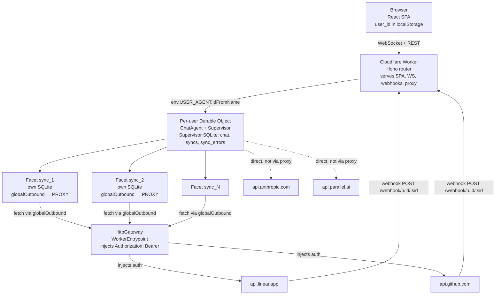
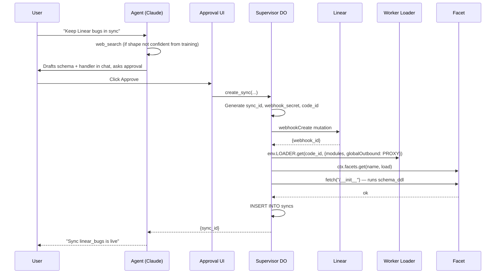
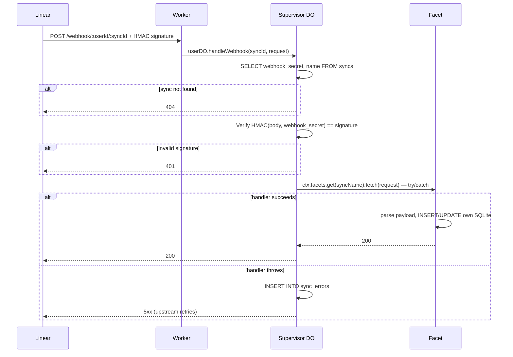

# Self-Syncing Agent — Architecture Design

**Date:** 2026-04-17
**Status:** Draft for implementation
**Upstream context:** `[spec.md](../../../spec.md)` — the assignment as given plus our scope and decisions
**Target:** V1 build for a 4-day trial

---

## 1. Context and scope

This document is the concrete architectural design for the V1 build of a self-syncing agent: a deployed system where a visitor lands on a URL, talks to an agent in plain language, and the agent writes its own webhook handler code + schema into isolated per-sync SQLite databases. Third-party data stays locally mirrored via webhook-driven ingestion, and the agent queries its own local copy at question time.

Key constraints carried over from `spec.md`:

- **Cloudflare-native** — Workers, Durable Objects, DO Facets, Worker Loader
- **TypeScript end-to-end**
- **Claude Opus 4.7** for agent reasoning via `@ai-sdk/anthropic` (released 2026-04-16; highest-tier model for code generation and multi-step tool reasoning)
- **Isolation is the primary grading signal** — must be demonstrable, not aspirational
- **4-day V1** — scope discipline; Pipedream and autonomous background agents are V2 stretch

Non-goals recap: multi-tenant auth, user OAuth flows, teams, billing, multi-thread per user.

## 2. Stack summary

| Concern         | Choice                                                                                           |
| --------------- | ------------------------------------------------------------------------------------------------ |
| Runtime         | Cloudflare Workers + Durable Objects                                                             |
| Sync execution  | DO Facets + Worker Loader (isolated SQLite per facet)                                            |
| Agent framework | Cloudflare Agents SDK (`@cloudflare/ai-chat`)                                                    |
| LLM             | Claude Opus 4.7 via `@ai-sdk/anthropic` (model ID `claude-opus-4-7`; supports `effort: "xhigh"`) |
| HTTP            | Hono                                                                                             |
| UI              | React (from starter), served by the Worker                                                       |
| Web search      | Parallel AI agentic search                                                                       |
| Package manager | pnpm                                                                                             |
| Node            | 22.x (pinned `.nvmrc` + `package.json#engines`)                                                  |

## 3. Identity and addressing

- **No auth.** Every visitor gets a client-minted UUID on first landing, stored in `localStorage`.
- **URL pattern:** `/user/:userId` is that visitor's agent page. The URL is the capability — sharing the URL shares the agent.
- **DO naming:** `env.USER_AGENT.idFromName(userId)` — the DO is created on first access. No server-side user registry; the DO existing _is_ the user record.

## 4. Topology

One Durable Object per user, extended from the starter's `ChatAgent`. That DO plays three roles:

1. **Chat agent** — manages conversation state (inherited from `AIChatAgent`)
2. **Supervisor** — owns the syncs registry, sync_errors log, and webhook signing secrets
3. **Facet orchestrator** — attaches, dispatches to, and manages N facets (one per sync) via `ctx.facets.get(syncName, loadCallback)`



**Facet isolation semantics** (confirmed from Cloudflare docs):

- A single DO can host an arbitrary number of named facets (`ctx.facets.get("name", ...)`)
- Each facet gets **its own isolated SQLite database** — "the dynamic code cannot read the supervisor's database"
- Each facet runs in a separate V8 isolate
- `globalOutbound` is set per facet at load time; passing a fetcher binding routes all outbound fetch through that fetcher; passing `null` blocks egress entirely

## 5. Data model

### 5.1 Supervisor SQLite (per user)

Lives in the user DO. Accessed via `this.sql` (Agents SDK).

`**chat_messages`\*\* — inherited from `AIChatAgent`. Messages persisted across reloads and dev restarts.

`**syncs**` — the registry:

| Column                | Type                       | Notes                                                                 |
| --------------------- | -------------------------- | --------------------------------------------------------------------- | --------------- |
| `id`                  | TEXT PRIMARY KEY           | UUID generated at creation                                            |
| `name`                | TEXT NOT NULL UNIQUE       | User-visible label; must be unique per user                           |
| `integration`         | TEXT NOT NULL              | `"linear"`                                                            | `"github"` (V1) |
| `handler_code`        | TEXT NOT NULL              | Agent-authored JS; module source                                      |
| `schema_ddl`          | TEXT NOT NULL              | Agent-authored SQL DDL; run in facet on init                          |
| `filter_description`  | TEXT                       | Human-readable description of what this sync tracks                   |
| `webhook_secret`      | TEXT NOT NULL              | 32-byte random, used for HMAC verification                            |
| `upstream_webhook_id` | TEXT                       | Returned by upstream when webhook registered (e.g. Linear webhook ID) |
| `code_id`             | TEXT NOT NULL              | Cache key for `env.LOADER.get(codeId, ...)`; bumps on update          |
| `version`             | INTEGER NOT NULL DEFAULT 1 | Handler version; incremented on `update_sync`                         |
| `created_at`          | INTEGER NOT NULL           | Unix ms                                                               |
| `updated_at`          | INTEGER NOT NULL           | Unix ms                                                               |

`**sync_errors**` — runtime failure log:

| Column            | Type                              | Notes                                                          |
| ----------------- | --------------------------------- | -------------------------------------------------------------- |
| `id`              | INTEGER PRIMARY KEY AUTOINCREMENT |                                                                |
| `sync_id`         | TEXT NOT NULL                     | FK to `syncs.id`                                               |
| `occurred_at`     | INTEGER NOT NULL                  | Unix ms                                                        |
| `payload_preview` | TEXT                              | First ~2KB of the webhook body, for debugging                  |
| `error_message`   | TEXT NOT NULL                     | `e.message`                                                    |
| `stack_trace`     | TEXT                              | `e.stack` if available                                         |
| `handler_version` | INTEGER NOT NULL                  | The version that failed; older errors preserved across updates |

`**connections**` — **V2 only.** Per-user Pipedream account bindings. Skipped for V1.

### 5.2 Facet SQLite (per sync)

The schema is **defined entirely by the agent** at sync creation time (via `schema_ddl`). The supervisor does not prescribe a shape. Typical example for a Linear issues sync:

```sql
CREATE TABLE issues (
  id TEXT PRIMARY KEY,
  title TEXT NOT NULL,
  state TEXT,
  labels TEXT,           -- JSON-encoded array
  assignee TEXT,
  created_at INTEGER,
  updated_at INTEGER,
  raw_payload TEXT       -- the full webhook body, for debugging and backfill
);
```

The supervisor never reads these tables directly. All reads go through `query_sync(sync_id, sql)`, which executes inside the facet.

## 6. Outbound egress and credentials

### 6.1 Gateway design

Each facet is loaded with:

```ts
globalOutbound: ctx.exports.HttpGateway({ props: { userId } });
```

`HttpGateway` is a `WorkerEntrypoint` class exported from the supervisor worker. When facet code calls `fetch("https://api.linear.app/...")`, Cloudflare's runtime routes the request to `HttpGateway.fetch(request)`. The gateway:

1. Extracts the target hostname
2. Looks up the appropriate credential (V1: from `env.LINEAR_ACCESS_TOKEN`; V2: from a per-user Pipedream lookup using `this.ctx.props.userId`)
3. Injects `Authorization: Bearer <token>`
4. Forwards via `fetch(request, { headers })`
5. Returns `403` for unknown hosts — facet code cannot reach arbitrary URLs

Minimal V1 implementation:

```ts
export class HttpGateway extends WorkerEntrypoint<Env, { userId?: string }> {
  async fetch(request: Request): Promise<Response> {
    const url = new URL(request.url);
    const headers = new Headers(request.headers);
    switch (url.hostname) {
      case "api.linear.app":
        headers.set("Authorization", `Bearer ${this.env.LINEAR_ACCESS_TOKEN}`);
        break;
      default:
        return new Response(JSON.stringify({ error: "unknown_host" }), {
          status: 403
        });
    }
    return fetch(request, { headers });
  }
}
```

### 6.2 V1 → V2 swap

V2 replaces the `switch` body with a Pipedream Connect lookup keyed on `this.ctx.props.userId`. No shared interface is needed because V1 and V2 aren't composed; V2 is a successor gateway class. The V1 → V2 transition is: replace the body of `HttpGateway.fetch`, or swap out the class reference at the facet-load site to a new `PipedreamGateway` class.

This is simpler than an abstract `CredentialSource` interface and matches the canonical Cloudflare pattern for egress control.

## 7. Inbound routing (webhooks)

- **URL shape:** `/webhook/:userId/:syncId`
- Both components are UUIDs. Server-to-server only; not user-visible.
- Worker parses URL → gets user DO by name → calls `userDO.handleWebhook(syncId, request)`
- No global webhook index needed. The user DO knows its own syncs.
- See section 10.2 for the detailed flow including signature verification.

## 8. Agent tool surface (9 tools)

### 8.1 Read tools (no approval)

| Tool                                     | Input                                     | Output                                                                           | Notes                                                                                                                 |
| ---------------------------------------- | ----------------------------------------- | -------------------------------------------------------------------------------- | --------------------------------------------------------------------------------------------------------------------- |
| `list_syncs()`                           | —                                         | `[{sync_id, name, integration, row_count, version, last_activity}]`              | Rich detail for the sync list UI                                                                                      |
| `get_sync(sync_id)`                      | `sync_id: string`                         | `{handler_code, schema_ddl, version, recent_activity, row_count, recent_errors}` | Full sync detail                                                                                                      |
| `get_sync_errors(sync_id, limit=20)`     | `sync_id`, `limit`                        | `[sync_error rows]`                                                              | Full stack traces + payload previews for debugging                                                                    |
| `query_sync(sync_id, sql)`               | `sync_id`, `sql: string`                  | `rows[]`                                                                         | **SELECT-only**; enforced in the facet                                                                                |
| `web_search(objective, search_queries?)` | `objective: string`, `queries?: string[]` | `[{url, title, excerpt, ...}]`                                                   | Parallel AI agentic mode; 10 results; 4KB excerpts. This is the agent's sole docs-verification primitive — see §11.1. |

### 8.2 Write tools (always approval via Agents SDK `needsApproval`)

| Tool          | Input                                                               | Output                   | Side effects                                                                                                                                            |
| ------------- | ------------------------------------------------------------------- | ------------------------ | ------------------------------------------------------------------------------------------------------------------------------------------------------- |
| `create_sync` | `{name, integration, schema_ddl, handler_code, filter_description}` | `{sync_id}`              | Registers upstream webhook, loads facet, initializes its SQLite, persists sync record. Transactional rollback on any step's failure.                    |
| `update_sync` | `{sync_id, schema_ddl?, handler_code?, migration_sql?}`             | `{version: number}`      | Bumps version + codeId. `migration_sql` runs inside the facet in a transaction before new code loads.                                                   |
| `delete_sync` | `sync_id: string`                                                   | `{ok: true}`             | Unregisters upstream webhook, drops facet, deletes sync record + related errors.                                                                        |
| `run_in_sync` | `sync_id: string, code: string`                                     | `{result, logs, error?}` | Loads the code into the target sync's facet at a one-shot `/exec` entrypoint. Same isolation as the handler. Enables backfill, diagnostics, data fixes. |

**Approval rationale:** every write tool always requires approval (no heuristic classification). The approval moment _is_ the "show generated code" UI moment, so this matches the assignment's UX ask naturally.

## 9. LLM context injection (caching-aware)

Claude's prompt cache only rewards stable prefixes. The design respects this:

**Message structure on every turn:**

```
[ system prompt  — stable, marked cache_control: ephemeral  ]  ← cache breakpoint
[ context messages — freshly built each turn, NOT cached   ]
[ conversation history — from this.messages                 ]
[ current user message                                       ]
```

**Context messages** are user-role messages with XML-delimited tags (Claude is trained to read these as ambient state, not user intent):

```
<active_syncs>
| sync_id | name | integration |
| abc-123 | linear_bugs | linear |
</active_syncs>

<sync_errors>
| sync_id | count_last_hour | last_error |
| abc-123 | 7 | TypeError: Cannot read property 'team' of undefined |
</sync_errors>
```

Empty state handled explicitly (`<active_syncs>No syncs registered yet...</active_syncs>`).

**Implementation sketch:**

```ts
async onChatMessage(_onFinish, options) {
  const syncs = this.sql`SELECT id, name, integration FROM syncs`.all();
  const errors = this.sql`SELECT sync_id, COUNT(*) as n, ... FROM sync_errors WHERE occurred_at > ? GROUP BY sync_id`.all(Date.now() - 3600_000);

  const contextMessages: ModelMessage[] = [
    { role: "user", content: formatActiveSyncs(syncs) },
    { role: "user", content: formatSyncErrors(errors) },
  ];

  const messages: ModelMessage[] = [
    ...contextMessages,
    ...await convertToModelMessages(this.messages),
  ];

  const result = streamText({
    model: anthropic("claude-opus-4-7"),
    system: [{
      type: "text",
      text: SELF_SYNCING_AGENT_SYSTEM_PROMPT,
      providerOptions: { anthropic: { cacheControl: { type: "ephemeral" } } },
    }],
    messages,
    tools: syncTools(this),
    stopWhen: stepCountIs(5),
    abortSignal: options?.abortSignal,
  });

  return result.toUIMessageStreamResponse();
}
```

## 10. Control flows

### 10.1 Sync creation



**Rollback rules** — if any step after webhook registration fails (facet load, init, registry write), the supervisor unregisters the Linear webhook and drops the facet, returning an error message that the agent surfaces to the user.

### 10.2 Webhook delivery (steady state)

Zero LLM cost. Agent does not run.



**Signature verification stays in the supervisor** — facet code never sees `webhook_secret`. Facets receive the fully validated request with raw body.

### 10.3 Query

Trivial; covered in prose:

1. User asks: "How many open bugs are in the Core team?"
2. Agent reads `<active_syncs>` ambient context, sees `linear_bugs` exists
3. Agent calls `query_sync("sync_abc", "SELECT COUNT(*) FROM issues WHERE state='open' AND json_extract(labels, '$') LIKE '%bug%' AND team='Core'")`
4. Query runs against the facet's SQLite; rows returned in milliseconds
5. Claude reads the result, answers in natural language

`query_sync` enforces SELECT-only (tool validates the SQL starts with SELECT or WITH after stripping comments; anything destructive requires `update_sync` or `run_in_sync`).

## 11. Error handling and recovery — two layers

### 11.1 Layer 1 — prevention (at code-generation time)

- **`web_search` (Parallel AI agentic mode)** — the agent's single docs-verification primitive. Used to look up webhook payload shapes, API conventions, error-code meanings, and anything else where confidence from training is insufficient. Returns up to 10 excerpts of ≤4KB each, ranked by relevance.
- **System prompt discipline** (written in Phase 07) — "Before drafting a handler for any integration, verify the webhook payload shape. If your training data is confident and recent, proceed; otherwise call `web_search` first. Never guess field names — if you're unsure, capture the whole payload into a `raw_payload` JSONB column and refine later via `run_in_sync`."
- **Conservative-first pattern for unknown integrations (V2 relevance)** — in a V2 Pipedream world, the agent defaults to "capture raw payload into a blob column" for integrations it doesn't recognize; subsequent deliveries + Layer-2 error recovery iteratively refine the handler.

Note: we explicitly rejected hand-curating a per-integration docs bundle. See §14.1.

### 11.2 Layer 2 — recovery (at runtime)

1. Every facet dispatch wrapped in try/catch in the supervisor (section 10.2)
2. On failure: row inserted into `sync_errors`, 5xx returned so upstream retries
3. On next chat turn: ambient context includes `<sync_errors>` summarizing recent failures
4. Agent can call `get_sync_errors(sync_id)` to see full stack traces and payload previews
5. Agent proposes `update_sync` with corrected handler; user approves; pending upstream retries succeed
6. `run_in_sync` enables backfill once the schema is right — ad-hoc code in the facet can re-fetch historical data via proxy and populate previously-empty rows

**Safeguards against fix-loops** (implementation note): if a new handler version fails within X minutes of shipping, flag to user in chat context rather than proposing another automatic fix. Hard cap of 3 auto-fix attempts per sync per day for V1.

## 12. Security and isolation invariants

All of these must be true and demonstrable:

1. **Cross-user isolation** — each user is one DO. No DO has read access to another DO's storage. DO names are UUIDs.
2. **Facet ↔ Supervisor isolation** — facet code cannot read supervisor SQLite. Each facet has its own isolated SQLite. (Confirmed from Cloudflare docs.)
3. **Facet ↔ Network isolation** — `globalOutbound: env.PROXY` on every facet. No raw network egress. Proxy rejects unknown hosts with 403.
4. **Credential isolation** — V1 integration secrets live only in Worker env. They are read by the proxy when injecting auth. They are never passed into facet environments.
5. **Ad-hoc code isolation** — `run_in_sync` reuses the target sync's facet; same sandbox, same proxy, same SQLite scope. It cannot reach other syncs or supervisor state.
6. **Supervisor-only services** — `api.anthropic.com` and `api.parallel.ai` are called by the supervisor DO directly, using env secrets. They are unreachable from facet code.

## 13. Extensibility (V2 paths)

Enumerated here so the V1 build is shaped to accept them without rework.

### 13.1 Pipedream Connect

- Add `connections` table to supervisor SQLite (user_id implicit, integration, base_url, pipedream_account_id).
- Add `connect_integration(integration)` tool that returns a Pipedream Connect auth URL for the user.
- Replace `HttpGateway.fetch`'s hostname switch with a per-user Pipedream Connect lookup keyed on `this.ctx.props.userId` (or swap the class reference at the facet-load site for a new `PipedreamGateway` class — either works).
- **No changes required to facet code or Worker Loader wiring.** Facets still see `globalOutbound: ctx.exports.<Gateway>({ props: { userId } })`; only the gateway's credential-lookup body changes.

### 13.2 Background agents (webhook-spawned)

After N consecutive sync failures, auto-spawn an agent run that reads errors, proposes a fix, and calls `update_sync` (still with user approval). Same tool surface, different trigger.

### 13.3 Docs caching

If `web_search` latency becomes demo-distracting, add a `docs_cache` table in supervisor SQLite keyed on `(integration, event_type)` to memoize search summaries. Not V1.

### 13.4 Rate limiting

Per-session message cap on the public URL to prevent LLM-cost abuse. Not V1.

## 14. Architectural decisions explicitly rejected

Listed so reviewers can see what we considered and decided against, and why.

### 14.1 Per-integration curated docs bundle

Proposed: ship `src/integrations/linear.ts` (etc.) containing webhook payload schemas, auth patterns, and gotchas; agent consults via a `get_integration_docs` tool before drafting handler code.

**Rejected because:**

- The agent (Opus 4.7) is the same LLM that would curate the bundle. The bundle adds no information the agent doesn't have from training.
- It doesn't generalize to V2: the V2 pitch is Pipedream Connect covering 3000+ integrations — we can't hand-curate.
- Curated docs drift silently from upstream reality; `web_search` is self-correcting per turn.
- Shipping it and then deprecating it in V2 signals weak architectural conviction. Skipping it signals trust in the bitter-lesson architecture end-to-end.

**Instead**: `web_search` (Parallel AI) is the single docs-verification primitive (§11.1), and Layer-2 runtime-error recovery (§11.2) catches any bad first drafts. Same mechanism works identically for V1's one integration and V2's thousands.

## 15. Out of scope for V1 (explicit)

- Multi-tenant authentication (cookies, sessions, real login)
- Third-party OAuth flows (user connecting their own Linear/GitHub/etc.)
- Pipedream Connect integration
- Autonomous agent loops (recovery is user-initiated in V1)
- Multi-thread per user (one implicit thread per user DO)
- Admin views, user enumeration, analytics
- Rich artifact editing beyond what the starter provides

## 16. Worker env secrets

| Secret                                            | Purpose                                                  | Notes                                                                            |
| ------------------------------------------------- | -------------------------------------------------------- | -------------------------------------------------------------------------------- |
| `ANTHROPIC_API_KEY`                               | Claude LLM calls                                         | Read directly by supervisor                                                      |
| `PARALLEL_API_KEY`                                | `web_search` tool                                        | Read directly by supervisor                                                      |
| `LINEAR_ACCESS_TOKEN`                             | Linear API auth (webhook registration + proxy injection) | V1 uses one shared demo-workspace OAuth access token; V2 Pipedream replaces this |
| `PIPEDREAM_CLIENT_ID` / `PIPEDREAM_CLIENT_SECRET` | Pipedream Connect                                        | V2 only                                                                          |

All provisioned via `wrangler secret put <NAME>` for deployed environments. Local dev reads from `.dev.vars` (gitignored).

## 17. Known DO Facets caveats (docs are thin)

Called out so that future sessions know what to verify on implementation:

- **`globalOutbound` configuration shape** — whether it takes a `Fetcher` object, a `{ service }` binding, or something else — needs verification against live CF docs before wiring the proxy.

- **Quota limits on facets-per-DO are not documented.** For V1, assume arbitrary — design is tolerant of whatever limit exists.

- **Facet cold-start latency is not documented.** First invocation of a facet after DO wake-up involves spinning up its isolate. If measured latency is high enough to cause webhook delivery timeouts, consider pre-warming or reshaping the facet lifecycle. (Separate concept from Worker Loader's code cache — see below.)

- **Worker Loader cache semantics are only partly documented.** Two things to get right:
  - **Cache keying (we control this):** every handler update MUST bump `code_id` — use `${sync_id}:v${version}` — to force a cache miss on Cloudflare's side. Reusing the same codeId silently serves stale compiled code. This is the load-bearing rule of the whole update path.
  - **Eviction and cold-compile latency (platform-managed, undocumented):** first load of a brand-new codeId compiles + spins up an isolate. Time unknown but expected tolerable for our scale. DO migration across regions (rare, platform-triggered) would invalidate the local compiled-code cache on the new location — a one-time latency bump, not a correctness issue.

- **Co-location is guaranteed.** DOs are location-bound; facets attached to a DO always run in the DO's location; Worker Loader invocations from inside that DO use that location's code cache. So for a single user's flow (chat + webhooks + facet execution), nothing crosses regions except the inbound webhook RPC from the edge Worker to the DO — which is by design.

---

**End of design.** Implementation plan lives in a separate document once this is approved.
